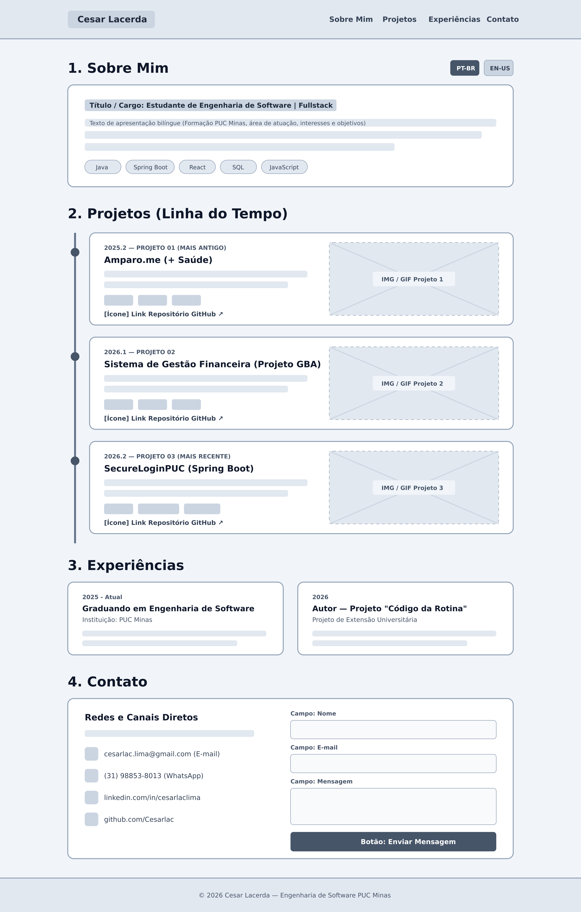

# Portfólio Profissional - Cesar Lacerda Lima


Projeto desenvolvido para o **Laboratório 01 (Portfólio Profissional)** da disciplina de **Desenvolvimento e Integração de Aplicações Web (DIAW)** do curso de **Engenharia de Software** da **PUC Minas**, sob orientação do **Prof. João Paulo Carneiro Aramuni**.

---

## 📌 Descrição do Projeto
Website de portfólio profissional responsivo desenvolvido para apresentar minha trajetória acadêmica, habilidades técnicas (com foco em Java, Spring Boot, React e SQL), linha do tempo de projetos desenvolvidos e canais de contato direto com envio integrado de e-mails.

As seções do sistema incluem:
1. **Sobre Mim:** Apresentação bilíngue (Português / Inglês) destacando formação, foco de atuação e tecnologias.
2. **Projetos:** Linha do tempo cronológica (do projeto mais antigo ao mais recente) com descrição, stack tecnológica, prévia visual e link para o repositório no GitHub.
3. **Experiências:** Histórico acadêmico e projetos de extensão universitária.
4. **Contato:** Links diretos para E-mail, WhatsApp, LinkedIn e GitHub, além de formulário validado com disparo real de e-mails via **EmailJS**.

---

## 🚀 Link para o Site Publicado na Nuvem (Vercel)
🔗 **Acesse o Portfólio Online:** [https://repositorio-cesar.vercel.app](https://repositorio-cesar.vercel.app)
*(Obs.: Substitua pelo link exato `.vercel.app` gerado no seu painel da Vercel)*

---

## 🛠️ Tecnologias, Dependências e Bibliotecas Utilizadas
- **[React.js](https://react.dev/) (`react`, `react-dom`):** Biblioteca JavaScript para construção da interface de usuário baseada em componentes e estados.
- **[Vite](https://vite.dev/) (`vite`, `@vitejs/plugin-react`):** Bundler e servidor de desenvolvimento front-end.
- **[Tailwind CSS](https://tailwindcss.com/) (`tailwindcss`, `@tailwindcss/vite`):** Framework CSS utilitário para estilização moderna e design responsivo.
- **[EmailJS](https://www.emailjs.com/) (`@emailjs/browser`):** Integração para envio de e-mails diretamente pelo front-end no formulário de contato.
- **[Lucide React](https://lucide.dev/) (`lucide-react`):** Biblioteca de ícones minimalistas para interface.
- **[Figma](https://www.figma.com/):** Prototipação e wireframes de média fidelidade.
- **[Vercel](https://vercel.com/):** Plataforma de hospedagem contínua na nuvem (CI/CD integrado ao GitHub).

---

## 🎨 Protótipos e Wireframes (Lab01S01)
Wireframe de média fidelidade planejado para a organização estrutural do layout:



---

## 📂 Estrutura de Diretórios do Projeto
```text
portfolio-profissional/
├── public/
│   ├── amparo.png          # Imagem do projeto Amparo.me
│   ├── horizon.png         # Imagem do projeto GBA
│   ├── securelogin.png     # Imagem do projeto SecureLoginPUC
│   └── wireframe.png       # Imagem do wireframe do sistema
├── src/
│   ├── App.jsx             # Componente principal (Seções, Timeline e Contato EmailJS)
│   ├── index.css           # Importação do Tailwind CSS e estilos globais
│   └── main.jsx            # Ponto de entrada da aplicação React
├── index.html              # Estrutura HTML base
├── package.json            # Gerenciamento de dependências e scripts
├── vite.config.js          # Configuração do Vite e plugin Tailwind
└── README.md               # Documentação completa do projeto

💻 Instruções de Instalação e Execução Local
Pré-requisitos
Node.js (versão 18 ou superior)

Git

Passo a passo
Clone o repositório:

Bash
git clone [https://github.com/Cesarlac/RepositorioCesar.git](https://github.com/Cesarlac/RepositorioCesar.git)
Acesse o diretório do projeto:

Bash
cd RepositorioCesar
Instale todas as dependências necessárias:

Bash
npm install
Inicie o servidor local de desenvolvimento:

Bash
npm run dev
Abra o navegador em http://localhost:5173.

👤 Autor
Cesar Lacerda Lima

Graduando em Engenharia de Software — PUC Minas

E-mail: cesarlac.lima@gmail.com

LinkedIn: linkedin.com/in/cesarlaclima

GitHub: github.com/Cesarlac